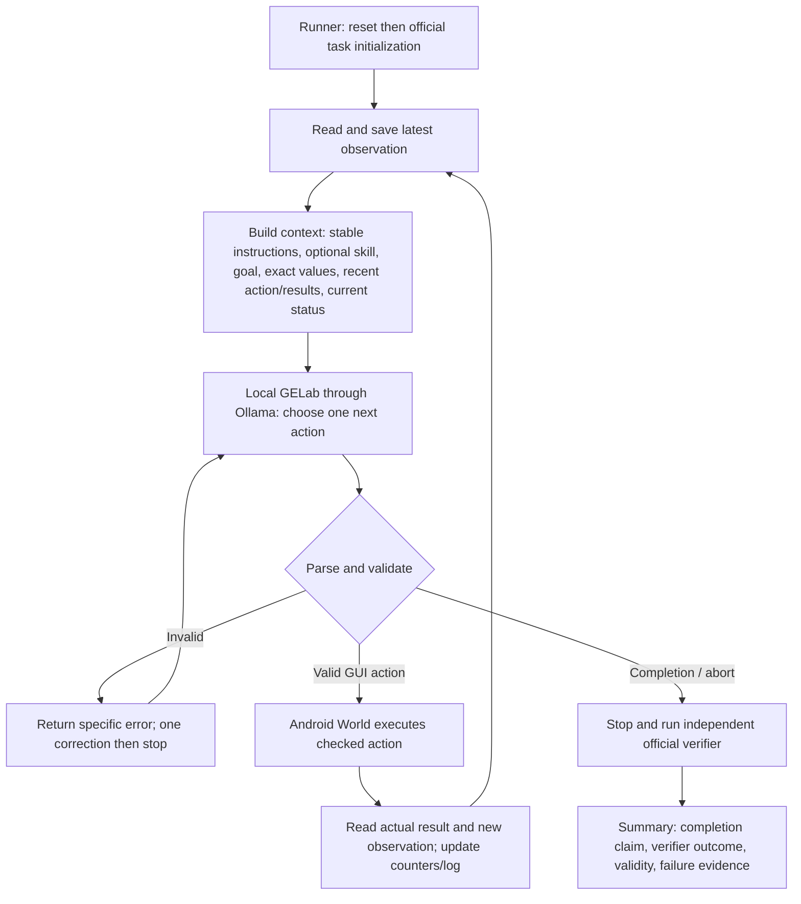

# Course-based agent build plan

Latest recorded Contacts trial: `trial_ContactsAddContact_20261007T173637_269613Z`, official FAIL, initial 0.0/final 0.0, 12 steps, 12 calls, 119.75 seconds, no manual intervention.

Logging, targeted TYPE and named label grounding are implemented. GPU22 is measured. Next gate remains repeated success on a frozen version, followed by the agreed Wi-Fi/Markor/Calendar/hard tasks and required evaluations. See PERFORMANCE_AND_TRAJECTORIES.md; earlier proposed stages below are historical.

## Earlier record (historical)

Latest result (7 October, 16:02 UTC run): official ContactsAddContact PASS,
initial score 0/final 1, ten GUI actions, eleven calls, 157.67 seconds, tree only.
Read `AGENT_WALKTHROUGH.md` first for the working loop and context repair.
Earlier status paragraphs below are historical planning notes. This learning
success does not replace final evaluation or the harder tasks.

Prepared 7 October 2026 after rereading the relevant slides, examples, and our
recorded failures. This is the plan for the next stages, not a claim that those
stages have been implemented or tested.

Execution update: see `GROUNDING_EXPERIMENTS.md`. Native examples worsened the
small comparison and were rejected. Constrained JSON gave 6/6 intended probe
actions and is now the learning format. Live Contacts executed eight actions
with no parse errors or image requests, but failed: partial surname, no phone/save,
then a freshness stop. Exact-value workflow guidance is the next untested proposal.

Latest user steering: basic tasks use tree observations with index grounding;
screenshots are a conditional fallback when the tree/indices are insufficient
or fail. Every decision still uses an observation. The selected comparison now
uses tree input in both conditions, keeping that choice fixed while testing the
three examples. This supersedes the open basic-task interface choice below.

## Decisions for the next stage

The user authorized selecting the disappeared question's answer from course
guidance. Selected: add three exact native action examples to the current English
prompt, then measure. Keep the model, hardware, sampling, parser, observations,
and budgets fixed in that first comparison. Do not translate the entire upstream
prompt in the same experiment.

Reason: D2 p.26 recommends a few high-quality examples for format/boundary
ambiguity. Our Contacts run reached a focused field and keyboard, then produced
`type:Camila` instead of an executable `action:TYPE` / `value:...` pair. Our Wi-Fi
run also returned bare terminal action names. Exact examples address a demonstrated
interface ambiguity with a small, inspectable change. They may still fail.

D1 p.27 puts constrained decoding, validation/retry, and clearer prompting in
that order. We already validate and allow one correction; this plan does not
treat examples as enforcement. Check whether this installed engine can enforce
the native protocol before introducing decoding constraints. Do not assume a
JSON format option enforces GELab's tab-separated action grammar. A new schema
would be a separate compatibility experiment.

## Do we need one skill per task?

No course project requirement says to create one skill for every Android task.
D1 p.6 requires one agent with `step()`, tasks across three difficulties, three
runs each, and video. D2 pp.30–33 teach reusable procedural knowledge and explicit
loading; they do not establish a one-file-per-task requirement.

In `D2/D2/step3_skill_status.py`, Python checks a trigger, reads a `SKILL.md`,
inserts its text into the request, and maintains status. Ollama does not find or
execute a file merely because it is named `SKILL.md`. Our current Android agent
has no such loader. `AGENTS.md` guides the development assistant; its contents
are not automatically included in GELab requests.

Use this sequence:

1. Establish the generic action/observation interface.
2. Diagnose a real procedural failure: skipped save, wrong order, misunderstood
   workflow, or lost subgoal, after the action format is usable.
3. If procedural guidance addresses it, compare one small skill with no skill
   on comparable task instances. Keep other settings fixed.
4. Retain the skill only with useful evidence; preserve negative results too.

Prefer a reusable workflow skill over a separate file for every benchmark task:
for example, note creation/checking can be shared by note, merge, and note-to-SMS
tasks. Calendar might need a separate guide. Choose actual files from failures,
not this list of possibilities.

A useful project skill would contain a trigger and scope, a short observation-led
procedure, common mistakes, exact-value handling, save/check conditions, and
failure/stop conditions (D2 p.31). It must not contain seed-specific answers,
fixed tap coordinates, database writes, or a recorded action sequence that
ignores the current screen. It guides the model; Python still validates and acts.

If implemented, load its text once into the run's context state and include it
in subsequent requests, because the model is stateless. Log path/version/content.
For this simple runner, an explicit task-family mapping is enough; no catalogue
search, extra agent, or framework is needed. This remains conditional.

## The target small architecture

The correction arrow permits one extra request for that step. All paths are
bounded by time, output, and step limits. The runner also stops on errors or
budget exhaustion and attempts final verification; completion is not required
to preserve an unsuccessful run's evidence.

Keep the existing files: `gelab_agent.py` for the single agent and action helpers,
`run_task.py` for setup/recording/evaluation, `agent_config.json` for reversible
settings, and `probe_connection.py` for nonexecuting interface probes. The
documented Windows adapter remains infrastructure. Add a skill file only if its
experiment is justified. Split long functions into small helpers when that makes
inputs, outputs, and flow easier to explain.

## Why Contacts failed and what each mechanism addresses

| Evidence | Diagnosis | Appropriate next change |
| --- | --- | --- |
| First run rejected appended `Contacts` / confidence annotations | Our parser was stricter than native reference behavior | Compatibility fix already tested: zero to four GUI actions, still FAIL |
| Repeat step 5 shows focused first-name field and keyboard; two malformed TYPE replies | Action-format failure; later contact logic is untested | Exact native examples; assess initial and corrected replies separately |
| Current requests resend actions but do not explicitly resend their execution results | Feedback is incomplete compared with D2 tool-loop example | A separate later experiment: recent action/result pairs with fresh observed facts |
| Wi-Fi model claimed completion while official score stayed zero | False completion claim, also malformed protocol | GUI check before completion; independent verifier remains decisive |
| First Wi-Fi trial had initial score 1 | Invalid starting state, not model success | Reset-before-initialize and unsatisfied-start guard already implemented |

The Contacts failure does not establish that a Contacts skill is needed, or that
the model cannot enter text. Text entry never executed in that run.

## Stages and evidence required before expanding

| Stage | Work and purpose | Evidence / gate | State |
| --- | --- | --- | --- |
| 0. Inspect and connect | Read materials; project venv; official environment; native model protocol; hardware probe; logs/video/verifier | Real observations and model-selected GUI actions | Done; no earned task PASS |
| 1. Make replies executable | Add exact CLICK, TYPE, COMPLETE examples to the English prompt | Saved-screen comparison: valid action arguments, correct intended action/target, exact text, latency | Next; selected, not executed |
| 2. Repeat Contacts | Run from official clean initialization with the same task seed; inspect every action and effect | Official PASS and understandable trace; retain failures; stop to diagnose the first blocking layer | Pending |
| 3. Strengthen feedback and termination | If needed, send recent action/result pairs; include code-observed current app/focus/UI change where available; inspect saved result before completion | Same-task before/after comparison; no claim of verified progress from a successful dispatch alone | Pending, changes tested separately |
| 4. Apply chosen observation/grounding | Tree/index first for basic tasks; screenshots only when needed or index approach fails | Check exposed controls and valid indices; log every fallback reason and selected action | User selected; implementation/measurements pending |
| 5. Expand learning tasks | Wi-Fi, MarkorCreateNote, then MarkorCreateNoteAndSms; configure official apps first | Successful verifier checks, exact-value transfer, app switching, explainable failures | Pending |
| 6. Add procedural guidance if needed | One short skill or TODO only for a demonstrated workflow/subgoal problem | Comparable runs with/without the mechanism, including cost and negative results | Conditional |
| 7. Preserve harder scope | SimpleCalendarAddOneEvent and jointly choose MarkorMergeNotes or OsmAndTrack | Real initialization, runs, official verification; budgets based on measured length/time | Pending; not replaced by easy-only scope |
| 8. Evaluate | Freeze baseline, task instances/seeds, versions and recording; at least one easy/medium/hard task, three runs each | At least nine baseline runs; rates/counts, videos, trajectories, one failure analysis and matched improvement results | Pending |
| 9. Prepare presentation | Explain context, skill versus tool, `step()`, validation, memory, verifier, and one failed trajectory | Every group member can explain code and reproduce the experiment | Pending |

Stage 2's inspection is analysis of recorded observations, not unlogged manual
taps during the run. A first PASS is a debugging milestone, not reliability
evidence. Final evaluation uses the required repeated runs.

The course recommends indices when the tree is useful (D1 p.41). We should test
that selected direction. It requires valid
GELab index output and useful exposed controls; our earlier probes proved neither.
An index resolves against its exact observation; it is not a permanent ID.
Hybrid image/tree input is a later candidate if single interfaces are insufficient.

Current learning guards remain 12 steps, 900 seconds, 120 seconds/request, 256
output tokens, and one invalid-reply correction. Longer tasks will need their
own measured budgets; a 39/60-step course example cannot simply inherit a
12-step limit. GPU layers 16 and sampling remain fixed in the next prompt test.
Temperature 0 or lower output variability is a separate candidate experiment
from D1 `step2_temperature.py`, not a guaranteed cure or simultaneous change.

## The next experiment, concretely

Compare prompt A (current `gelab_english_v2`) with prompt B (same instructions
plus three exact native action examples). Keep original task values out of the
examples. Illustrate generic CLICK, exact TYPE, and evidence-based COMPLETE;
the coordinates in examples are syntax examples, not targets to reuse.

Use saved Contacts focused-field and Wi-Fi observations/contexts, with their
trees in both conditions. Mode-specific contracts are the same in A and B;
three examples are the only within-comparison change. These are
interface probes with no device actions. Preserve screenshot and exact request,
raw reply, parsing/argument errors, selected action, intended target assessment,
and timing. Use three repetitions per condition per saved screen, alternate
condition order, and separate cold loading from warm timing as in D2's cache lab.
Report first-reply validity separately from validity after the one correction.
No saved-screen result is an official task PASS.

If the format improves without losing action correctness, repeat the complete
Contacts task with the same seed and independent verifier. If it does not,
inspect protocol/rendering and feasible decoding constraints before accumulating
skills or many rules. Do not loosen parsing into guessing an ambiguous action.

## What makes failure less likely and visible

- **Feedback:** give the next decision actual observations and action outcomes.
  A dispatched tap is not proof that it hit the intended control.
- **Constraints:** code checks actions, arguments, fresh targets, budgets, and
  recording. Instructions cannot override these checks.
- **Recovery:** invalid output gets a specific error and one correction; uncertain
  execution stops instead of repeating a possible write. Change strategy from
  evidence; no endless retries.
- **Memory:** preserve exact task values and later screen-derived values within
  the run, with their source. Reset run memory between evaluations. Logs stay full
  even when model context is compact.
- **Verification:** inspect the GUI result before completion, then check the
  official verifier independently. Keep false claims and invalid initial states.

These mechanisms reduce and expose failures; they do not guarantee every run.
Skills help with procedure, not missing perception, bad coordinates, parser bugs,
or a verifier bypass. Keep those diagnoses separate.

## Source mapping

All numbers are PDF pages, starting at 1. These are supplied course materials;
we have not executed their archived programs or treated example results as ours.

| Source | Guidance used |
| --- | --- |
| Syllabus p.1; D1 pp.6–7, 49–50 | Required agent, task categories, repeated evaluation, video, logs, failures and improvement |
| D1 pp.24, 27–28, 33–41 | Output contracts, format drift, runtime actions/memory/verification, bounded loop, observation and grounding |
| D2 pp.24–26, 30–39, 43–45 | Process over rule stacking, few examples, conditional skill loading, code-maintained status, memory/context tradeoffs |
| D3 pp.6–7, 9–12, 19–20 | Action/result feedback, narrow operations, clear argument and observation interfaces |
| D4 pp.18, 23–27, 29–30 | Feedback, verification, constraints, bounded recovery, deterministic enforcement |
| D5 pp.40–42 | Fix knowledge/instructions/programs at the appropriate layer; outcome alone does not establish an acceptable path; training is not the first step |
| D1 `step2_temperature.py`, `step3_context_growth.py`, `step4_chat_template.py` | Controlled sampling experiments, explicit history, actual rendering checks |
| D2 `step1_tool_context.py`, `lab_support.py` | Checked execution, returned errors/results, bounded loops, independent evidence snapshots |
| D2 `step2_prefix_cache.py` | Alternating comparisons, warm/measured separation, raw metrics without invented speedup |
| D2 `step3_skill_status.py`, example `SKILL.md` | Explicit trigger/read/injection; procedural text; code-maintained attempted-call status |
| D2 `step4_memory.py` | Save/reload memory explicitly; its hard-coded extraction is a teaching simplification, not our extraction mechanism |

The core course pattern is model + selected context + checked tools + feedback,
controlled by a small harness. Skills are one optional way to supply procedure.
