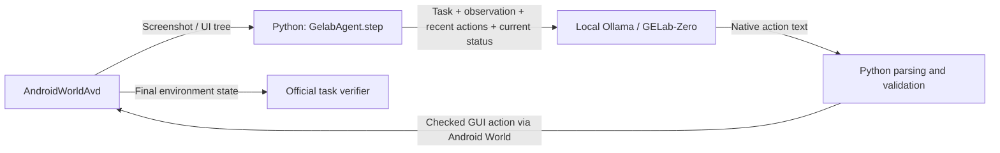

# Connecting GELab-Zero to the emulator

Current learning policy is tree/index first with conditional screenshots, using
constrained JSON actions. See `GROUNDING_EXPERIMENTS.md`. The native walkthrough
below describes the original stage; historical runs retain original settings.

There is no direct model-to-emulator connection. Our Python harness connects
two local interfaces: Ollama HTTP on `localhost:11434` and Android World, which
uses ADB plus the emulator's gRPC port `8554`.



## The small program

- `gelab_agent.py`: one agent class with `step(goal)`. Helper functions read the
  native action protocol, check arguments, and convert coordinates.
- `run_task.py`: selects an official task, initializes it, records video, runs
  a bounded step loop, and calls its official verifier. It does not choose taps.
- `agent_config.json`: provisional settings that can be edited for the next run;
  every run saves its own copy. Existing results retain their original settings.
- `probe_connection.py`: compares screenshot/coordinate and tree/index requests
  on the same captured observation. It never executes the returned actions.
- `android_compat.py`: the previously documented Windows APK handoff adapter.

The agent follows the reference tab-separated action protocol described in
[GELab's parser](https://github.com/stepfun-ai/gelab-zero/blob/7b619f6f67d2b1101021fc453cb27bd48a29e4f2/copilot_tools/parser_0920_summary_adv.py).
We use a shorter English adaptation of its prompt, not the complete upstream
agent framework. The published and installed Ollama model both declare
`RENDERER qwen3-vl-instruct`, `PARSER qwen3-vl-instruct`, and `TEMPLATE {{ .Prompt }}`.
Thus the template field alone was not evidence of a broken installation.

## One step, explained

1. **Read:** Android World returns pixels and UI elements from the test emulator.
   Save the original screenshot and tree. For image requests, preserve aspect
   ratio and cap the longer side at 1280 pixels; save this exact model input too.
2. **Assemble:** send the trusted goal, latest observation, last three executed
   actions, exact task parameters as scratch memory, and the current status.
   Previous status snapshots stay in the log instead of growing the request.
3. **Ask:** Python sends a standard role-based request to Ollama's `/api/chat`.
   The server runs the already installed local model. No cloud inference occurs.
4. **Parse:** read the single native action. For example,
   `action:CLICK` followed by a tab and `point:616,405`.
5. **Validate:** check allowed action, required arguments, bounds, app name, and
   observation-local indices. No Python/shell text from the model is executed.
   Invalid replies receive one correction attempt; another invalid reply stops.
6. **Execute:** convert normalized coordinates and execute through Android World.
   Then save a fresh observation. Example: on a 1080 × 2400 display,
   `(616,405)` becomes approximately `(665,972)` pixels.
7. **Repeat or stop:** the task loop repeats one action at a time until model
   completion, an error, repeated identical actions without UI change, or a budget.

The model's `verify`, `note`, or explanation fields are visible model claims.
They are not the official task verifier. A completion claim and a PASS result
are recorded separately.

## Task initialization and verification

`ContactsAddContact` asks for a generated name and phone number. Seed 42 produced
`Camila da Silva`, `+10433218196`. The values are simulator task data.

The official initializer clears the emulator's contact provider and sets its
benchmark time. The official verifier checks whether that exact name/number
exists in the resulting contacts. Python does not create the contact directly.
`SystemWifiTurnOn` similarly uses the official initializer and Wi-Fi verifier.

Reset the environment **before** initializing the task, following the official
minimal runner. A diagnostic measured score 0 immediately after Wi-Fi
initialization and score 1 after a subsequent environment reset. Our first Wi-Fi
trial used the wrong order: its initial and final scores were both 1 and it
executed zero GUI actions. Its recorded PASS is therefore excluded from agent
success results, as explained in that run's `analysis.json`. Version
`learning_gpu16_v3` fixes ordering and refuses to run these learning tasks if
their initial verifier score is not zero. This is initialization work, not an
agent action or a model-quality improvement.

Only the infrastructure app and required task app are configured. Contacts
onboarding emitted a setup warning about a missing notification button, so the
agent can encounter the remaining notification prompt. That is recorded in the
trial rather than hidden through unlogged manual taps.

## How to run

From the project directory, start the existing AVD with its explicit port:

```powershell
& "$env:LOCALAPPDATA\Android\Sdk\emulator\emulator.exe" -avd AndroidWorldAvd -no-snapshot -grpc 8554
```

An Android Studio launch without this explicit port caused an authentication
error in our first connection attempt. Wait until the emulator has booted.

```powershell
& '.\.venv\Scripts\python.exe' probe_connection.py --num-gpu 16
& '.\.venv\Scripts\python.exe' run_task.py --task ContactsAddContact
& '.\.venv\Scripts\python.exe' run_task.py --task SystemWifiTurnOn
```

These are learning trials, not the final three-run-per-task evaluation. The
default trial interface is provisional screenshot/coordinates because the
model's published protocol is visual; our paired index probes have not yielded
valid index actions. This does not establish a baseline winner or require
abandoning the tree/index objective. `--observation tree` is experimental.

## Provisional settings and evidence

The first CPU probes took 58.01/66.38 seconds; corrected prompts took
46.99/64.81 seconds. Their action replies were invalid for the target probe.
One apparent completion reply is a failed target selection, not success.

At the user's request, we tested 16 layers of GPU offload using the same BF16
model. Ollama reported about 4.19 billion bytes of GPU residency on the 8 GB RTX
4070 Laptop GPU. The first request including reload took 67.70 seconds; the
following tree request took 12.08 seconds. One warm result is not a reliable
speedup estimate. Cold loading and different request content confound comparison.

Trial settings: model-default temperature 1, top-k 20, top-p 0.95, context 4096,
generation seed 42, output cap 256, GPU layers 16. Learning limits: 12 steps,
900 seconds total, at most 120 seconds per request, one invalid-reply correction,
last three actions, and waits limited to five seconds. These are provisional
guards based on initial timings, not course-prescribed settings or a final baseline.

## First failure and narrow parser correction

Trial `trial_ContactsAddContact_20261007T143813_228879Z` made two model requests
but executed zero GUI actions. The model selected the Contacts icon and appended
unkeyed labels/confidence text, which our first parser rejected. It stopped after
one correction; official verifier score was 0.0 (FAIL). Its MP4 is readable.

The reference parser ignores unkeyed annotations. Our correction accepts short
labels/numeric annotations as metadata while preserving strict action/argument
checks. Duplicate actions, unknown actions/apps, malformed annotations,
out-of-bounds points/indices, and nonfinite waits remain rejected. We repeated
the same seed/model/task with this parser change; the repeat opened Contacts,
opened the creation form, and focused the first-name field (four GUI actions).
At step 5 the model returned `type:Camila` plus unkeyed coordinates/labels twice,
instead of `action:TYPE` and `value:Camila`. Neither reply was executed. The
official verifier again returned 0.0 (FAIL); no contact was saved. This is an
adapter/format improvement with no task-success improvement: 0/1 before and
0/1 after. One matched pair is too small for a reliability conclusion.

| Contacts learning version | GUI actions executed | Model calls | Official result | Duration |
| --- | --- | --- | --- | --- |
| `learning_gpu16_v1` | 0 | 2 | FAIL | 29.67 s |
| `learning_gpu16_v2` | 4 | 6 | FAIL | 145.41 s |

Run IDs: `trial_ContactsAddContact_20261007T143813_228879Z` and
`trial_ContactsAddContact_20261007T144105_002848Z`. Full raw replies and
independent verifier results remain in those run folders. The next candidate
improvement is clearer native action examples in the prompt, rather than
guessing execution from malformed text. The user delegated this choice to course
guidance; three exact examples are now selected for the next isolated experiment,
which has not been run. See `AGENT_BUILD_PLAN.md` for the complete course-based
architecture, skill policy, staged experiments, and evaluation gates.

Invalid Wi-Fi run: `trial_SystemWifiTurnOn_20261007T144747_582753Z`.
Initialization diagnostic: `.review/wifi_start_diagnostic.json`. The controlled
diagnostic uses official initialization and verifier reads; it is not an
evaluation run. The corrected learning trial uses the same inference prompt
and hardware settings; code/status metadata changes are versioned separately.

Corrected Wi-Fi trial: `trial_SystemWifiTurnOn_20261007T145351_459076Z`, version
`learning_gpu16_v3`. Initial score 0, final score 0 (FAIL), one GUI action,
three model calls, 60.84 seconds. GELab opened Settings with a valid AWAKE action,
then returned a bare `COMPLETE` token rather than `action:COMPLETE`. Its correction
was a bare `INFO` token. Both were rejected. The completion text claimed Wi-Fi
was on despite the official score of zero; this is a visible false completion
claim, while the primary stop category is `validation_error`. Agent completion
is false because neither terminal reply was accepted.

Observation review correction: the AWAKE action was dispatched, but step 2's
saved tree still shows the launcher. The earlier sentence claiming Settings
opened was too strong. Use this observed state when interpreting the failure;
dispatch is not proof of the intended effect. Original run evidence is unchanged.

Valid learning results so far: Contacts 0/2 (0%), Wi-Fi 0/1 (0%). Exclude the
already-satisfied Wi-Fi trial. These tiny learning samples are not the final
course evaluation or a general reliability estimate. No task PASS has yet been
earned through this agent.

## Reading the logs

Each `runs/trial_.../` folder has the task/parameters, configuration snapshot,
progress, summary, and MP4 clips. Each step folder has before/after screenshots,
the UI tree, exact prompt text/settings with an image-file reference, raw API
responses/timings, normalized action, execution result, and any validation error.
The image reference is base64-encoded only for transmission, not dumped into the
readable request log. Source step files remain intact for failure analysis.
Version 3 additionally copies the exact small program into `source/`, records
model digest/dependency/server versions, and timestamps execution starts. Earlier
trials predate those additions; their missing metadata is not invented later.

Android screenrecord is split into clips near its 180-second limit. The agent
waits for recording readiness before acting during rollover. Static-screen clips
may contain very few frames; inspect both video and timestamped API/action logs
when analyzing time spent waiting. Video validity/coverage remains a check before
the final evaluation, and missing/broken recording is not silently accepted.
All four learning trial clips decoded without corruption. The second Contacts
clip contains 661 frames with the last timestamp at 146.10 s. Static failed
trials contain only two or three frames; these short/static clips alone do not
prove complete wall-time coverage. Retain their `video_validation.json` reports.
The corrected Wi-Fi clip contains 128 frames and a last-frame timestamp of
58.91 s. No recorder process remained after cleanup. Dependency consistency and
Python syntax checks passed; these checks do not establish task success.
